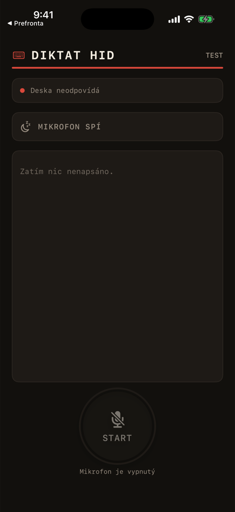

# DiktatHID ⌨️🎙️

**Dictate on your iPhone, have it typed on any computer — through a tiny board that pretends to be a keyboard.**

```
iPhone (speech recognition)
   │  Wi-Fi
   ▼
ESP32-S3  ── USB HID keyboard ──►  PC
```

The computer sees nothing but an ordinary USB keyboard. No driver, no app, nothing to install on the PC.

<p align="center">
  
</p>

## How it works

- **iPhone app** listens, transcribes on the device and sends the text to the board over Wi-Fi.
- **ESP32-S3 firmware** (ESP-IDF + TinyUSB) enumerates as a USB keyboard and types the text key by key.
- **Keyboard layout mapping.** Typing Czech characters through a raw keyboard is the hard part: the board has to press the right keys for the layout the PC uses. A tested table maps Czech QWERTZ (including háčky and čárky) to HID scancodes.

## Status

| Part | State |
|---|---|
| Czech QWERTZ → HID mapping | done, tested on host |
| Bluetooth HID prototype (ESP32 WROOM-32) | works — used to verify the mapping on real Windows |
| USB HID firmware (ESP32-S3) | builds, waiting for the board |
| iOS app | builds and runs, waiting for a test with the board |

## Stack

C · ESP-IDF · TinyUSB · Swift · SwiftUI · Speech

The source code is not public.

## License

© 2026 Pletnajs. All rights reserved.
